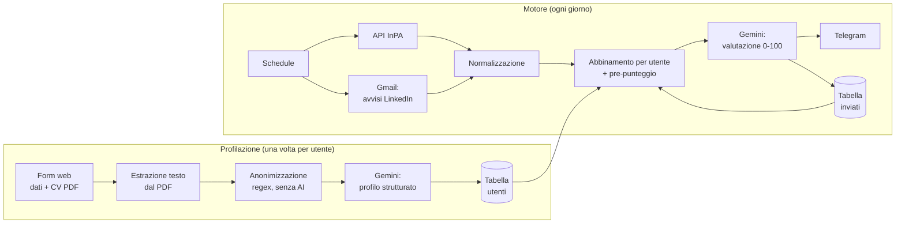

# CercaLavoro AI 🔎🤖

**Automazione con n8n che cerca ogni giorno bandi pubblici e offerte di lavoro, li confronta con il CV di ogni utente tramite AI e manda su Telegram solo quelli davvero adatti.**

Progetto personale nato da un'esigenza reale: controllare a mano ogni giorno portali come InPA e LinkedIn richiede tempo, e la maggior parte degli annunci non è adatta al proprio profilo. Questo sistema lo fa in automatico, per più utenti, ognuno con il proprio profilo e le proprie preferenze.

---

## Come funziona



1. **Profilazione** – L'utente compila un form con i suoi dati, le preferenze (regione, disponibilità a spostarsi, patenti) e carica il CV in PDF. Il testo viene estratto e **anonimizzato** (email, telefono, codice fiscale, link, nome) prima di essere inviato all'AI, che restituisce un profilo strutturato: livello di istruzione, competenze, esperienze, progetti, ruoli adatti e parole chiave.
2. **Raccolta** – Ogni giorno il motore scarica i nuovi bandi dall'API del portale **InPA** e legge gli **avvisi di lavoro LinkedIn** dalla casella email, trasformando tutto in un formato comune.
3. **Abbinamento** – Per ogni utente, i bandi vengono filtrati (titolo di studio, zona, parole chiave, offerte già valutate) e ordinati con un **pre-punteggio** gratuito. Solo i più promettenti passano alla fase successiva.
4. **Valutazione** – Gemini valuta i bandi di ogni utente **in un'unica richiesta**, con punteggio, motivazione e requisiti da verificare.
5. **Notifica** – L'utente riceve su Telegram solo le offerte sopra soglia, ordinate per punteggio. Tutte le valutazioni vengono salvate, così nessun bando viene rivalutato o rimandato.

---

## Esempio di notifica

```
🏛 BANDO PUBBLICO · InPA
🟢 82/100 — Istruttore informatico
🏢 Comune di …
📍 Sicilia - Palermo ⭐
⏳ Scadenza: 15/12/2026 12:00

💬 Profilo coerente con le competenze di sviluppo web e il diploma richiesto…
⚠️ Da verificare: eventuale patente B

🔗 Apri il bando
```

<!-- Aggiungi qui uno screenshot:  -->

---

## Scelte progettuali

| Problema | Soluzione |
|---|---|
| **Privacy dei CV** | Il testo del CV viene ripulito dai dati personali con regex **dentro n8n**, prima di raggiungere qualsiasi servizio esterno. I dati identificativi restano solo nel database locale. Lo storico delle esecuzioni della profilazione non viene salvato. |
| **Limite di richieste del piano gratuito di Gemini** | Una sola richiesta per utente al giorno (valutazione "a lotti"), pre-filtro e pre-punteggio senza AI, massimo 15 bandi valutati per utente. |
| **Affidabilità dell'AI** | Output strutturato con schema JSON fisso e **modello di riserva**: se il modello principale fallisce o esaurisce la quota, subentra automaticamente un secondo modello. |
| **Bandi duplicati o persi** | Memoria **per utente** (tabella `inviati`): ogni coppia utente–bando viene valutata una sola volta; i bandi non valutati oggi vengono ripresi nei giorni successivi; i nuovi utenti ricevono anche i bandi ancora aperti. |
| **Fonti diverse** | Ogni fonte viene normalizzata nello stesso formato. Le fonti pubbliche (InPA) valgono per tutti; quelle private (avvisi email personali) solo per il loro proprietario. |
| **Errori silenziosi** | Un workflow dedicato (*Error Trigger*) avvisa l'amministratore su Telegram se un'esecuzione fallisce. |
| **Rispetto dei termini d'uso** | Nessuno scraping: InPA tramite la sua API pubblica, LinkedIn tramite gli avvisi email ufficiali. |

---

## Tecnologie

- **n8n** (self-hosted con Docker) – orchestrazione dei workflow
- **JavaScript** – nodi Code per normalizzazione, anonimizzazione, abbinamento e pre-punteggio
- **Google Gemini** – profilazione dei CV e valutazione dei bandi (output strutturato)
- **n8n Data Tables** – database locale (utenti, valutazioni inviate)
- **Gmail API** (OAuth2) – lettura degli avvisi di lavoro
- **Telegram Bot API** – notifiche
- **API portale InPA** – bandi della Pubblica Amministrazione

---

## Struttura del repository

```
workflows/
  01-profilazione-cv.json       Form → PDF → anonimizzazione → profilo AI → tabella utenti
  02-motore-multiutente.json    Raccolta → abbinamento → valutazione AI → Telegram
  03-avvisi-errori.json         Notifica su Telegram degli errori di esecuzione
docs/
  …                             Screenshot e schema dell'architettura
```

---

## Installazione

### 1. Avviare n8n con Docker

```bash
docker volume create n8n_data

docker run -d --name n8n --restart unless-stopped -p 5678:5678 \
  -e GENERIC_TIMEZONE="Europe/Rome" -e TZ="Europe/Rome" \
  -v n8n_data:/home/node/.n8n \
  docker.n8n.io/n8nio/n8n
```

Poi apri `http://localhost:5678`.

### 2. Creare le Data Tables

**`utenti`**

| Colonna | Tipo |
|---|---|
| email | String |
| nome | String |
| cognome | String |
| regione | String |
| disponibilita | String |
| patenti | String |
| livelloIstruzione | String |
| paroleChiave | String |
| profilo | String (JSON) |
| attivo | Boolean |
| telegramChatId | String |

**`inviati`**

| Colonna | Tipo |
|---|---|
| email | String |
| idBando | String |
| fonte | String |
| titolo | String |
| link | String |
| punteggio | Number |
| notificato | Boolean |

### 3. Importare i workflow

In n8n: **Create workflow → ⋯ → Import from file**, per ognuno dei file in `workflows/`.

### 4. Configurare le credenziali

Le credenziali **non sono incluse** nel repository. Vanno create in n8n:

- **Google Gemini API** – chiave da Google AI Studio
- **Gmail OAuth2** – client OAuth da Google Cloud Console (redirect: `http://localhost:5678/rest/oauth2-credential/callback`)
- **Telegram API** – token del bot creato con @BotFather

### 5. Sostituire i segnaposto

| Dove | Segnaposto |
|---|---|
| `02-motore-multiutente` → nodo *Estrai offerte LinkedIn* | `LA_TUA_EMAIL@gmail.com` (email del proprietario degli avvisi LinkedIn) |
| `03-avvisi-errori` → nodo *Telegram* | `IL_TUO_CHAT_ID` (chat che riceve gli avvisi di errore) |

Infine, nelle impostazioni dei workflow 01 e 02 imposta **Error Workflow = Avvisi errori** e pubblica i workflow.

---

## Autore

**Vincenzo Calvaruso** – Sviluppatore Full-Stack Junior
GitHub: [Enxos27](https://github.com/Enxos27)
